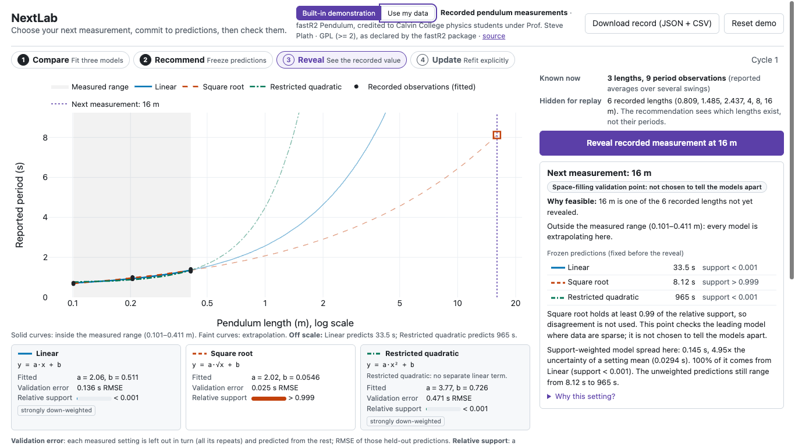

# NextLab

NextLab helps a research trainee decide which measurement to take next. You load a few
observations of one input and one response. NextLab fits three candidate models, picks
the next setting, and freezes each model's prediction for it. After the result comes in,
it compares the result with those frozen predictions and refits only when you ask. No
analysis code is needed.



_A real capture of the running app (headless Brave, 1366×768), taken after "Recommend next measurement" on the built-in demo._

## Quick start

These commands assume the one-time setup below has been done.

```sh
./nextlab
```

The command builds the web page, starts the Julia server on `127.0.0.1:8080`, warms up the
analysis code, and prints `NextLab READY at http://127.0.0.1:8080`. On the laptop used to
build it, that took about 15 s from a clean start. Open the URL; the built-in demo loads
by itself. Readiness, reset and crash recovery are in `docs/LAUNCH.md`.

One-time setup (macOS on Apple silicon, as used here):

```sh
brew install juliaup && juliaup add release            # Julia 1.13.2
julia --project=backend -e 'using Pkg; Pkg.instantiate()'
npm --prefix frontend ci                               # Node 26, npm 11
```

After setup, the demo needs no internet connection. The dataset, the plotting library and
all page assets are local. A local server process must be running.

## The problem it addresses

A trainee who can read a plot but does not write analysis code faces the same steps each
time they extend a series of measurements:
- fit a few candidate relationships and compare them
- choose the next setting to measure
- write down what each model predicts before measuring
- compare the new result with those predictions
- refit and see what changed

Done by hand, the prediction step is easy to skip, and predictions get revised after the
result is known. NextLab turns these steps into one guided loop and keeps a record of each
step.

The intended user is a research trainee. No trainee or experimental researcher has tested
NextLab yet.

## The loop

1. **Compare.** NextLab fits three models to the observations.
2. **Recommend.** It picks one feasible setting and freezes each model's prediction there.
3. **Reveal or measure.** In the demo, you reveal the recorded value at that setting. With
   your own data, you type in the value you measured.
4. **Update.** You compare the result with the frozen predictions, then refit explicitly.

The frozen predictions are never recomputed. "Download record" saves each recommendation,
its frozen predictions, the later observations and the order of updates.

The three models each have two fitted parameters, a and b:
- linear: `y = a·x + b`
- square root: `y = a·√x + b`
- restricted quadratic: `y = a·x² + b`, which has no separate linear term

## Two ways to use it

**Built-in demonstration (recorded data replay).** The demo uses the fastR2 `Pendulum`
dataset, which records pendulum length in metres and reported period in seconds. Each period is a
reported average over several swings.
- The replay starts with the three shortest lengths (9 observations).
- The other six lengths stay hidden, and "Reveal" shows all three reported periods at the
  one selected length.
- The recommendation code sees which lengths exist, but not their periods. A test changes
  every hidden period and checks that the recommendation does not change.

**Use my data.** Upload a CSV with a header row and pick the input and response columns.
- Labels and units are yours; NextLab does not convert units.
- Repeated x values are kept as repeats.
- You set the feasible next settings, as a range with a step, a list of values, or both.
- Every uploaded row counts as already observed.
- After a recommendation, you enter the measured value yourself; NextLab never simulates it.

## Data source and licence

The built-in data is the `Pendulum` dataset from the R package fastR2 (*Foundations and
Applications of Statistics Using R*, 2nd edition). Its documentation credits Calvin
College physics students under Professor Steve Plath. I did not collect these data.
- The package declares the licence GPL (>= 2).
- The source file's SHA-256 matches a recorded hash, and its values match the snapshot in
  `data/pendulum/`.
- Links, hashes, column meanings and limitations: `data/README.md`.

## Method

The full specification is in `docs/SPEC.md`, under "Numerical method", version `nextlab-core-1`.

**Fitting.** Repeated measurements at one x are averaged. Each distinct x counts once in
the fit. Each model is fitted by least squares, solved with a QR decomposition. The
coefficients agree with R's `lm()` to a relative tolerance of 1e-10.

**Validation error.** NextLab leaves out one distinct x at a time, including all of its
repeats, and predicts it from the rest. This is the error shown on the model cards. The
in-sample fit error is not displayed as if it were error on unseen data.

**Noise.** Variability comes from the repeats when there are any. Otherwise it uses a
response SD that you state. Otherwise noise is reported as unknown. The app shows the SD
of individual observations separately from the uncertainty of a setting's mean.

**Relative support.** Each model gets a weight, w ∝ exp(−(L − min L)/(2s²)), from its
validation error L. This is a heuristic weight, not a probability that the model is true.

**Recommendation.** NextLab picks the feasible, unmeasured setting where the
support-weighted predictions disagree most. If one model has at least 0.99 of the support,
or the models agree, it instead picks the setting farthest from any measured one, and
labels it a space-filling validation point. The app also reports when the separation is
low, and flags (heuristically) when every model misses the measured variability.

Least squares, leave-one-group-out validation, weighting models by validation error,
disagreement sampling and maximin space filling are all established techniques. What I built
is the combination, together with a workflow that freezes predictions before each result.

## Simulation benchmark

The question was whether, at the same measurement budget, NextLab's choices lead to better
predictions at unseen inputs than simple strategies. The protocol (`docs/BENCHMARK.md`)
was committed before any run (commit `dac3e46`).

The design:
- four generating relationships, one of them outside all three models
- two assumed Gaussian noise levels
- two starting layouts
- four policies that differ only in how they choose the next setting
- 100 seeds per condition
- three observations per setting, adding settings from 3 to 8

Prediction error is measured against the noiseless relationship at 200 test inputs that
never coincide with a candidate setting.

Results at 8 settings (24 observations per run), out of 16 simulated conditions:

| NextLab compared with | Better | No clear difference | Worse |
|---|---|---|---|
| Uniform random choice | 11 | 5 | 0 |
| Preplanned evenly spaced settings | 8 | 7 | 1 |
| Endpoints first, then the largest gap (maximin) | 2 | 14 | 0 |

- "Better" means the 95% bootstrap interval of the mean paired difference lies entirely below zero.
- Against the endpoints-then-maximin baseline, the per-condition mean differences ranged
  from 6.9% lower to 7.5% higher error. Two favourable results among 48 comparisons are
  about what chance alone would produce.
- At smaller budgets NextLab was sometimes clearly worse. That was most marked when the
  true relationship was outside the three models, because the rule kept choosing settings
  near the ends of the range.

**What this supports.** In simulation, NextLab's choices produced final predictions about
as accurate as a strong space-filling design, and more accurate than random choice in most
conditions. It did not show an advantage over the strong baseline.

These are simulated results only. They do not show how many fewer experiments anyone would
need.

To reproduce the run (16 conditions, 100 seeds, 38,400 rows; about 7 s here):

```sh
julia --project=backend --threads=auto backend/scripts/run_benchmark.jl full 100
```

Output goes to `results/benchmark_full/`. A rerun with a different number of threads gave
byte-identical files.

## Architecture

The backend is a Julia 1.13 package (`backend/`). It uses HTTP.jl, JSON.jl and CSV.jl,
plus the standard libraries (LinearAlgebra, Statistics, Random, SHA, Dates).
- `models.jl` and `analysis.jl` hold the scientific core. It sees only observed (x, y)
  pairs and candidate x values.
- `record.jl` makes frozen prediction records.
- `demo_adapter.jl` and `replay.jl` read the demo data.
- `upload.jl` parses CSV files.
- `benchmark.jl` holds the simulation and the evaluator.
- `api.jl` is a stateless JSON API, documented in `docs/API.md`.

The frontend is Vite, React and TypeScript (`frontend/`), with the Plotly basic bundle for
the plot.
- The browser holds the experiment state and sends it with every request.
- Each snapshot carries a content-hash ID, and each request carries a revision. The server
  rejects an altered snapshot. The page ignores any response from before a reset or a
  data change.
- In production, `./nextlab` serves the built page and the API from one Julia process.

## Tests

```sh
julia --project=backend --threads=auto,1 -e 'using Pkg; Pkg.test()'   # 386 checks
julia --project=backend backend/scripts/api_smoke.jl http://127.0.0.1:8080
CHROME="/Applications/Brave Browser.app/Contents/MacOS/Brave Browser" \
  node frontend/scripts/browser-check.mjs http://127.0.0.1:8080 /tmp/nextlab-shots   # 68 checks
```

The browser check drives headless Brave through both workflows. It also covers:
- double clicks
- reset during a pending request
- simulated server failures
- CSV errors
- exports
- keyboard focus
- whether any request leaves localhost

The acceptance audit is in `docs/ACCEPTANCE.md`.

## Known limitations

- **Demo choices.** On the pendulum replay, all six recommendations are space-filling
  checks; the disagreement rule never decides there. The square-root model leads
  throughout. Even so, at 16 m its frozen prediction (8.12 s) missed the recorded mean
  (7.79 s) by about 11 times the estimated uncertainty of a mean, so the noise model is too
  simple for these data.
- **Noise model.** It assumes independent observations with one constant variance, and
  treats x as exact. In the pendulum data, scatter grows with length.
- **Inputs and models.** There is one input variable and three fixed models. Weights and
  "low separation" labels are heuristics, not calibrated probabilities or confidence
  intervals.
- **Evidence.** The benchmark is simulation only. No user testing has been done, and no
  prior-art comparison with existing experimental-design tools has been made.
- **Testing scope.** The app was tested only in headless Brave, at 1366×768 and 1280×720.
  Browser state is lost on reload, so download the record first.

## Out of scope

- chat or language-model features
- literature search
- symbolic regression or free-form equation discovery
- accounts, databases or collaboration
- sensors or live instruments
- more than one input variable

## Development

Two terminals, with live reload:

```sh
julia --project=backend --threads=auto,1 backend/scripts/serve.jl   # API on :8080
npm --prefix frontend run dev -- --host 127.0.0.1                   # page on :5173
```

The other documents:
- `docs/SPEC.md`: decisions
- `docs/STATUS.md`: current state
- `docs/DEMO.md`: demo script
- `docs/DEVPOST.md`: submission text
- `docs/JUDGE_QA.md`: likely judge questions

Third-party code includes the Julia packages and npm packages listed in `backend/Project.toml`
and `frontend/package.json`. The development tools and AI assistance used are listed in
`docs/DEVPOST.md`.
